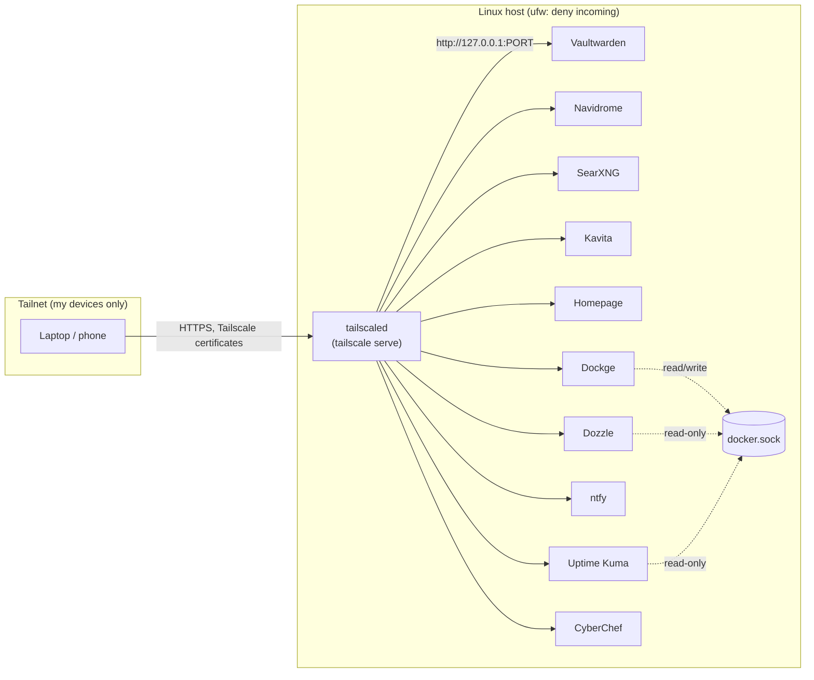

# Homelab


A small self-hosted stack that runs on one Linux laptop: password manager, music, search, books and manga, monitoring, and a few tools. Everything runs in Docker, listens only on `127.0.0.1`, and is published to my private Tailscale network over HTTPS. Nothing is exposed to the LAN or the internet.

I built it to practice sysadmin, DevOps and security basics on real hardware (8 GB RAM, one disk) instead of a throwaway lab. The interesting parts are the design decisions and the things that broke along the way, which are written up below.

## Architecture



Tailscale terminates TLS with a certificate it issues and renews itself, so there is no reverse proxy and no certificate cron job. Every container publishes its port on `127.0.0.1` only, so the only way in is through the tailnet.

## Services

| Service | Purpose | Tailnet HTTPS port | Local port |
|---|---|---|---|
| Vaultwarden | Password manager | 443 | 8081 |
| Navidrome | Music streaming | 8443 | 4533 |
| SearXNG | Private metasearch | 10000 | 8080 |
| Kavita | Books and manga reader | 5000 | 5002 |
| Homepage | Dashboard linking to everything | 3010 | 3010 |
| Dockge | Docker stack manager (GUI) | 5001 | 5001 |
| Uptime Kuma | Container monitoring | 3001 | 3002 |
| ntfy | Push notifications | 8091 | 8091 |
| Dozzle | Read-only log viewer | 8888 | 8888 |
| CyberChef | Encode, decode and hash tool | 8100 | 8100 |

## Design decisions

- **Tailscale instead of a reverse proxy.** `tailscale serve` gives valid HTTPS and tailnet-only access in one step. I first ran Caddy with a self-signed certificate, but it only fronted one service and caused browser warnings, so I removed it.
- **Everything binds to `127.0.0.1`.** A service that listens on `0.0.0.0` depends on the firewall alone. Binding to localhost means a firewall mistake does not expose it.
- **No DNS filter in the stack.** AdGuard Home would have fought NextDNS and systemd-resolved over port 53 on the same host. NextDNS already covers this machine, so I dropped AdGuard.
- **Pinned image versions.** No `latest` tags (Dockge and Uptime Kuma use a major-version tag). A bad upstream release cannot break a restart, and the repo describes the same setup on every clone.
- **Docker container monitors, not network probes.** Uptime Kuma checks whether each container is running through a read-only Docker socket. Network probes failed because the services listen on localhost and Tailscale names do not resolve from inside the container. The limitation is that it shows a container is up, not that the app inside it answers.
- **Whitelist `.gitignore`.** The repo ignores everything and only allows compose files, example env files, scripts and docs. A new data folder or key file cannot be committed by accident.
- **Secrets stay out of git.** Real values live in gitignored `.env` files, and each stack ships a `.env.example`. The Vaultwarden admin token is stored as an Argon2 hash.

## Quick start

Requirements: Linux with Docker and the Compose plugin, and Tailscale with HTTPS certificates enabled (admin console, DNS, Enable HTTPS).

```bash
git clone https://github.com/AmuraXD7/Homelab.git ~/docker
cd ~/docker
```

1. **Create the env files.** Copy each `.env.example` to `.env` in `vaultwarden/`, `homepage/` and `ntfy/`, and set `TS_HOSTNAME` to your Tailscale machine name (for example `myhost.tailnet-name.ts.net`).
2. **Generate the Vaultwarden admin token** (this is the hash, and you type the password you choose when logging in to `/admin`):
   ```bash
   docker run --rm -it vaultwarden/server:1.36.0 /vaultwarden hash
   ```
   Paste the whole `ADMIN_TOKEN='$argon2id$...'` line into `vaultwarden/.env`. Keep the single quotes. If you do not want the admin page, delete the `ADMIN_TOKEN` line from the compose file and the page is disabled.
3. **Fix the absolute paths.** `dockge/compose.yaml` and `kavita/compose.yaml` contain `/home/amura/...`. Change them to your own home directory. Create the data folders for Navidrome first so the container user can write to them:
   ```bash
   mkdir -p navidrome/data navidrome/music
   ```
4. **Start the stacks.**
   ```bash
   for d in vaultwarden navidrome searxng dockge homepage uptime-kuma ntfy dozzle cyberchef kavita; do
     (cd "$d" && docker compose up -d)
   done
   ```
5. **Publish them on the tailnet.**
   ```bash
   sudo ./scripts/tailscale-serve.sh
   ```
6. **First-run setup.** Create the admin accounts in Dockge, Uptime Kuma, Kavita and Navidrome with strong, unique passwords. In Dozzle, turn on login and leave Actions and shell off. In Uptime Kuma, choose SQLite, add a Docker host with the socket `/var/run/docker.sock`, and add one Docker Container monitor per service.

## Repository layout

```
.
├── <service>/compose.yaml     one folder per stack
├── <service>/.env.example     required variables (real .env is gitignored)
├── homepage/config/*.yaml     dashboard tiles (hostname comes from .env)
├── scripts/
│   ├── tailscale-serve.sh     publish every service on the tailnet
│   ├── backup.sh              encrypted backup of the stack and its data
│   └── harden-host.sh         firewall, SSH and automatic updates (dry run by default)
├── .github/workflows/ci.yml   compose validation, shellcheck, secret scan
├── SECURITY.md                threat model and security decisions
└── README.md
```

## Backups

```bash
sudo ./scripts/backup.sh
```

This briefly stops the SQLite-backed services so their databases are consistent, archives the whole stack directory, encrypts it with GPG (AES-256) and restarts what it stopped. Some data folders are owned by root because containers write them, which is why it needs `sudo`. Copy the resulting `.gpg` file off the machine and test a restore now and then. A backup that has never been restored is only a hope.

## What broke, and what I learned

Real problems from building this, in roughly the order I hit them.

- **Expired TLS certificate.** Vaultwarden served its own certificate from a file copied out of Tailscale, and nothing renewed it. Browsers showed `ERR_CERT_DATE_INVALID` and HSTS blocked the click-through. I added a cron job at first, then removed it: Tailscale already renews the certificate it serves, so I let Vaultwarden run plain HTTP on localhost behind `tailscale serve`.
- **502 from a TLS mismatch.** The `tailscale serve` rule forwarded plain HTTP to a Vaultwarden that still expected TLS. A request that works against one port and fails through the proxy usually means the two sides disagree about the protocol.
- **Saved admin config overrode my environment.** Vaultwarden's admin panel writes `data/config.json`, which wins over environment variables. A plaintext admin token I had removed from the compose file was still active from that file. The log warning that settings were being overridden pointed straight at it.
- **Compose treated `$` in a hash as variables.** Pasting an Argon2 hash into the compose file made Compose expand `$argon2id`, `$v` and `$m` as empty variables, which mangled the token. The hash belongs in a single-quoted `.env` value, referenced as `${ADMIN_TOKEN}`.
- **Port collisions.** Uptime Kuma could not bind 3001 because an unrelated process already used it. That process listened on all interfaces, so I bound it to localhost with a systemd override. The firewall already blocked it, but I did not want one layer to be the only protection.
- **Wrong container port.** CyberChef returned nothing on the port I guessed (8000, then 80). `docker image inspect` showed the image exposes 8080. Check what an image declares before guessing.
- **`latest` was not what I expected.** Uptime Kuma's `latest` tag still pointed at the unmaintained v1 line, and its own UI warned about it. Pinning versions caught that early.
- **Embedded git repositories and root-owned files.** Old project folders with their own `.git` showed up when I ran `git add`, and root-owned container data blocked a plain `rsync` backup. The whitelist `.gitignore` and a `sudo` backup script fixed both.

## Limitations and next steps

- Uptime Kuma checks containers, not application health.
- ntfy is open to anyone on the tailnet. Next: add users and access rules, then wire Uptime Kuma alerts to it.
- Dockge mounts the Docker socket read-write, which is effectively root on the host. It is acceptable on a single-user machine behind Tailscale, but it is the largest trust assumption in the stack.
- Add image vulnerability scanning (Trivy) to CI and pin GitHub Actions by commit SHA.
- Restrict access with Tailscale ACLs so only specific devices reach specific ports.

## License

MIT, see [LICENSE](LICENSE).
